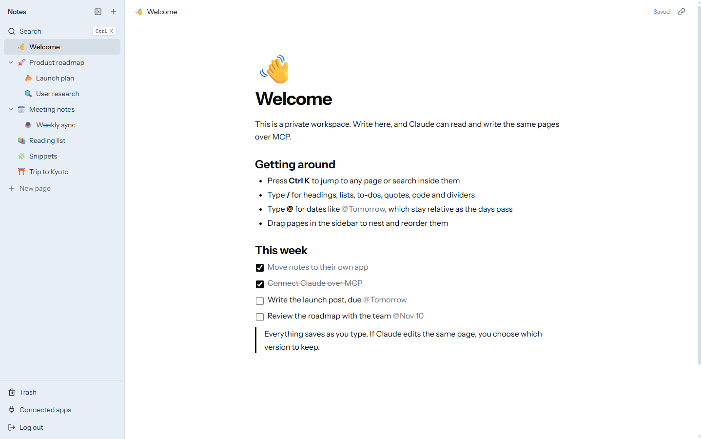
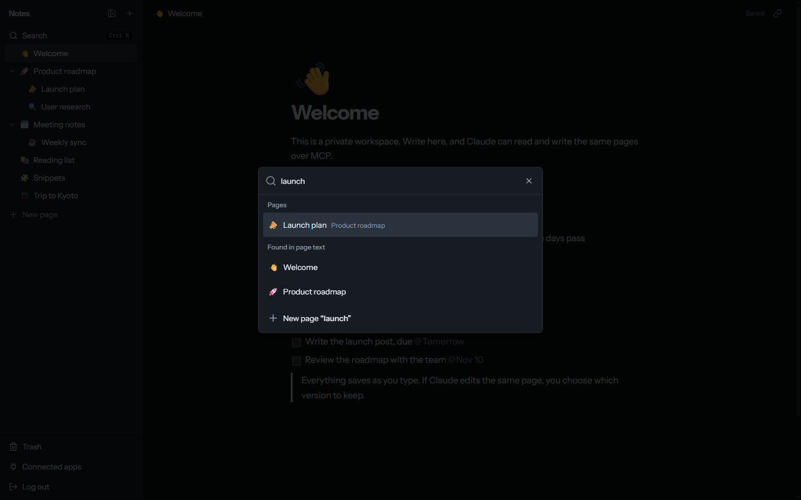
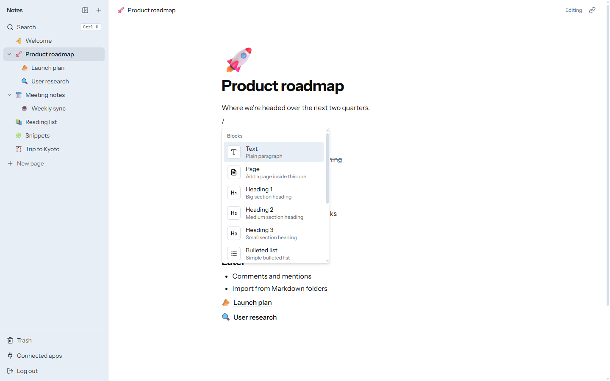

<div align="center">


# note-scion

**A private, Notion-style notes app that Claude can read and write.**

A block editor with nested pages for you, and the same pages for Claude over
[MCP](https://modelcontextprotocol.io). Self-hosted: your notes stay in your own database.

[](https://github.com/pradprat/note-scion/actions/workflows/ci.yml)
[](LICENSE)
[](https://nextjs.org)
[](#connect-claude)

**[Try the live demo →](https://notes.pradprat.blue/demo)**

[Features](#features) · [Deploy](#deploy) · [Connect Claude](#connect-claude) · [Development](#development) · [Security](#security)

</div>

<br>

<picture>
  <source media="(prefers-color-scheme: dark)" srcset="docs/screenshot-dark.png">
  
</picture>

## Why

Notes are most useful when your assistant can see them too. note-scion is a calm, fast
writing space for one person, with a built-in MCP server, so Claude can look up what you
already wrote, draft new pages, and keep lists up to date, from claude.ai, Claude Code or
any MCP client.

## Features

Every feature below works in the [demo](https://notes.pradprat.blue/demo), except Claude:
there, pages live in your browser's storage, so no MCP server can reach them.

**Writing**

- **Block editor** built on Tiptap: headings, lists, to-dos, quotes, code blocks and
  dividers, from the `/` menu or Markdown shortcuts. Drag any block by its handle.
- **Dates that stay true**: type `@` for Today, Tomorrow, "next friday" or any date. They
  read as relative dates and stay correct as the days pass.
- **Autosave with conflict detection**: edits save as you type. If Claude or another tab
  changed the page in the meantime, you choose which version to keep, so nothing is
  silently overwritten.

**Organising**

- **Nested pages**: a page tree in the sidebar, with drag-and-drop to nest and reorder, and
  sub-page blocks inside pages.
- **Quick switcher**: `Ctrl K` / `⌘ K` searches titles and the text inside pages, or
  starts a new page.
- **Trash**: deleted pages wait 30 days, with an undo right after a delete.

**For Claude**

- **MCP server** with seven tools: list, search, read, create, update, move and delete
  pages. Page bodies go in and out as Markdown.
- **OAuth 2.1** with dynamic client registration, PKCE and rotating refresh tokens, so
  claude.ai connects with nothing but a URL. **Connected apps** lists and revokes access.

**Everyday**

- Fast: pages are cached on the server and prefetched when you hover them.
- Light and dark themes that follow your system. Works on phones too.

<table>
  <tr>
    <td width="50%"></td>
    <td width="50%"></td>
  </tr>
  <tr>
    <td align="center"><sub>Quick switcher: titles and full text</sub></td>
    <td align="center"><sub>The <code>/</code> menu</sub></td>
  </tr>
</table>

## Deploy

note-scion runs on [Vercel](https://vercel.com) with a [Neon](https://neon.tech) Postgres
database. Both have free tiers that are more than enough for one person.

[](https://vercel.com/new/clone?repository-url=https%3A%2F%2Fgithub.com%2Fpradprat%2Fnote-scion&project-name=note-scion&repository-name=note-scion&env=NOTES_PASSWORD,NOTES_SESSION_SECRET&envDescription=The%20password%20that%20opens%20your%20notes%2C%20and%20a%20random%20secret%20of%2032%2B%20characters%20that%20signs%20the%20login%20cookie.&envLink=https%3A%2F%2Fgithub.com%2Fpradprat%2Fnote-scion%23environment-variables&products=%5B%7B%22type%22%3A%22integration%22%2C%22protocol%22%3A%22storage%22%2C%22productSlug%22%3A%22neon%22%2C%22integrationSlug%22%3A%22neon%22%7D%5D)

1. Click **Deploy with Vercel**. It copies the repo to your GitHub account and adds a Neon
   database to the project, which sets `DATABASE_URL`.
2. Fill in `NOTES_PASSWORD` and `NOTES_SESSION_SECRET` when asked. For the secret, run
   `openssl rand -base64 32`.
3. Open your new site and log in.

The build creates the tables on its own the first time, so there is no migration to run.

### Environment variables

| Variable | Required | |
| --- | :---: | --- |
| `DATABASE_URL` | yes | Postgres connection string. Set by the Neon integration. `POSTGRES_URL` is read as a fallback. |
| `NOTES_PASSWORD` | yes | The password that opens the workspace. Make it long. |
| `NOTES_SESSION_SECRET` | yes | Signs the login cookie. 32+ random characters. |
| `NOTES_MCP_TOKEN` | | A static bearer token (32+ characters) for MCP clients you configure by hand. Not needed for OAuth clients such as claude.ai. |

<details>
<summary><b>Deploying somewhere else</b></summary>

<br>

note-scion is a standard Next.js app, so it runs anywhere Next.js does (`npm run build`,
then `npm start`). It needs a Neon database, or any Postgres reachable through
[Neon's serverless driver](https://github.com/neondatabase/serverless). The build creates
the tables when `DATABASE_URL` is set. Otherwise run `bun run db:migrate` once.

</details>

## Connect Claude

Your MCP endpoint is `https://<your-site>/api/mcp`.

**claude.ai**: Settings → Connectors → **Add custom connector**, and paste the endpoint.
Claude finds the OAuth server on its own, registers, and sends you to your site to approve
the connection.

**Claude Code**, signing in with OAuth:

```sh
claude mcp add --transport http notes https://<your-site>/api/mcp
```

or with the static token from `NOTES_MCP_TOKEN`:

```sh
claude mcp add --transport http notes https://<your-site>/api/mcp \
  --header "Authorization: Bearer $NOTES_MCP_TOKEN"
```

Then ask things like *"what's on my reading list?"* or *"add today's decisions to the
weekly sync page"*.

| Tool | |
| --- | --- |
| `list_pages` | The page tree, with ids |
| `search_pages` | Find pages by title or text |
| `read_page` | A page as Markdown, with its path and sub-pages |
| `create_page` | A new page, optionally inside another, with a Markdown body |
| `update_page` | Change a title, icon or body (replace or append) |
| `move_page` | Nest a page under another, or move it to the top level |
| `delete_page` | Send a page to the trash (restorable for 30 days) |

## Development

Requires [Bun](https://bun.sh) and a Neon database (a free branch works well for
development).

```sh
git clone https://github.com/pradprat/note-scion.git
cd note-scion
bun install
cp .env.example .env.local   # fill in the values
bun run db:migrate
bun dev                      # http://localhost:3000
```

| Command | |
| --- | --- |
| `bun dev` | Start the dev server |
| `bun run build` | Create the tables (if a database is configured) and build |
| `bun run typecheck` | Type-check |
| `bun run lint` | Lint |
| `bun run db:migrate` | Create the tables |

### The demo

`/demo` is public and needs no database. It runs the same views as the real workspace
over a store kept in localStorage ([`src/app/demo/_lib/demo-store.ts`](src/app/demo/_lib/demo-store.ts)),
behind the same interface the server actions implement
([`src/app/_components/backend.tsx`](src/app/_components/backend.tsx)). Sample pages are
written in Markdown in [`seed.ts`](src/app/demo/_lib/seed.ts). A page is `/demo?page=<id>`,
so every demo route is a static file and visitors never cost a server render.

### How it's built

Next.js 15 (App Router, server actions), React 19, Tailwind CSS with
[shadcn/ui](https://ui.shadcn.com), [Tiptap 3](https://tiptap.dev), and the
[MCP TypeScript SDK](https://github.com/modelcontextprotocol/typescript-sdk). All data is
one `notes_pages` table plus three OAuth tables ([`scripts/schema.sql`](scripts/schema.sql)).
Page bodies are stored as Tiptap JSON and converted to and from Markdown for MCP.

```
src/
├── app/
│   ├── (app)/           the workspace: page view, trash, connected apps
│   ├── demo/            the public in-browser demo
│   ├── _components/     editor, sidebar, quick switcher and the rest of the UI
│   ├── api/mcp/         the MCP server
│   ├── oauth/           the OAuth authorization server
│   └── .well-known/     OAuth discovery documents
└── lib/                 database access, sessions, OAuth, Markdown conversion
```

## Security

note-scion is built for **one person**. There are no user accounts: one password signs a
30-day session cookie (HMAC-SHA256), and every page load and server action checks it
again. MCP access needs an OAuth access token bound to your endpoint, or the static token.
Only hashes of OAuth tokens and codes are stored.

Use a long, random password and session secret. To report a vulnerability, please see
[SECURITY.md](SECURITY.md).

### Staying inside the free tiers

Vercel's Hobby plan and Neon's free plan never bill you; past their limits they pause the
project instead. note-scion keeps strangers from spending those limits for you:

- Requests that don't carry a well-formed token or client id are refused before they
  reach the database, so junk traffic doesn't keep the database awake.
- Open client registration is capped at 20 an hour, and registrations nobody approved
  are cleared after a day, so the database can't be filled from outside.

On a public deployment, two [Vercel Firewall](https://vercel.com/docs/vercel-firewall)
rules (both free on Hobby) take care of the rest: a rate limit of about 120 requests a
minute per IP on `/api/`, `/oauth/`, `/session`, `/login` and `/.well-known/`, and a
rule denying scanner paths such as `/wp-`, `/.env` and `*.php`. Requests the firewall
blocks don't count toward your usage.

## Contributing

Issues and pull requests are welcome. See [CONTRIBUTING.md](CONTRIBUTING.md).

## License

[MIT](LICENSE) © Pradika Fitra Pratama
